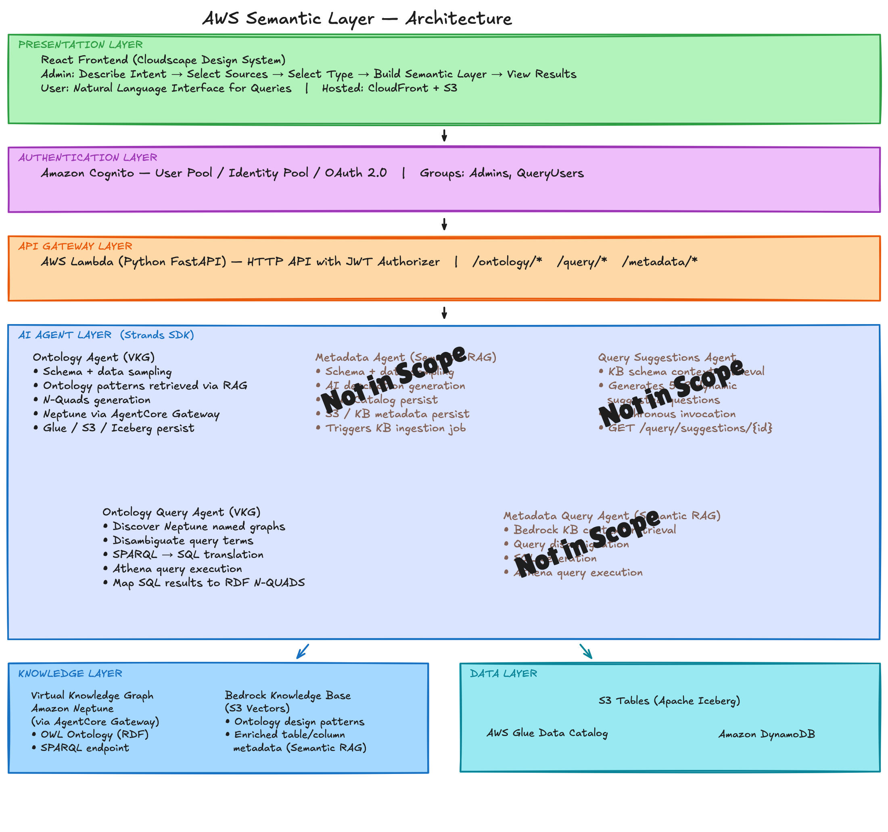

# Sample Semantic Layer for Structured Data — Virtual Knowledge Graph (VKG)

## Overview

This project implements a **Virtual Knowledge Graph (VKG)** semantic layer for structured insurance data on AWS. An OWL ontology is generated from your AWS Glue catalog, persisted in Amazon Neptune, and used to translate natural-language questions into SQL executed on Amazon Athena.

This is a customer-facing distribution focused on the VKG path. For the full reference implementation (including Semantic RAG, real-time CDC, and the AgentCore evaluation harness) see the parent repo: https://github.com/aws-samples/sample-semantic-layer-structured.

### Key Capabilities

- **Virtual Knowledge Graph in Amazon Neptune** — business concepts, relationships, and `mapsToTable` / `mapsToColumn` traceability stored as RDF/OWL
- **AI-Powered Ontology Generation** — schema sampling + retrieval of design patterns from a Bedrock Knowledge Base produces OWL N-Quads written back to Neptune, with AI-generated column/table descriptions written back to the Glue Data Catalog (including S3 Tables / Iceberg)
- **Versioned, iterative semantic layer creation** — pointer + history pattern for human-in-the-loop refinement
- **Natural Language Queries** — agents translate plain English to SPARQL → SQL → Athena
- **Federated query** — Athena bridges DynamoDB (operational) and S3 Tables / Apache Iceberg (analytical)
- **Glue Zero-ETL batch replication** — DynamoDB → S3 Tables `zetl_<uuid>` namespaces, normalized via 40 Glue 5.1 materialized views
- **Bedrock Guardrails** — INPUT and OUTPUT screening on every query

## Demo

### Virtual Knowledge Graph Flow


## Architecture



```
┌────────────────────────────────────────────────────────────────┐
│                      PRESENTATION LAYER                        │
│  React Frontend (Cloudscape Design)                            │
│  - Admin: Describe Intent → Select Sources → Build VKG → View │
│  - User: Natural Language Interface for Queries                │
│  Hosted: CloudFront + S3                                       │
└────────────────────────────────────────────────────────────────┘
                              ↓ HTTPS
┌────────────────────────────────────────────────────────────────┐
│                    AUTHENTICATION LAYER                        │
│  Amazon Cognito - User Pool / Identity Pool / OAuth 2.0        │
│  Groups: Admin, Users                                          │
└────────────────────────────────────────────────────────────────┘
                              ↓
┌────────────────────────────────────────────────────────────────┐
│                       API GATEWAY LAYER                        │
│  AWS Lambda (Python FastAPI) — HTTP API with JWT authorizer    │
│  Endpoints: /ontology/* /query/* /datasource/* /neptune/*      │
└────────────────────────────────────────────────────────────────┘
                              ↓
┌────────────────────────────────────────────────────────────────┐
│                    AI AGENT LAYER (Strands)                    │
│  ┌──────────────────────┐  ┌──────────────────────────────┐    │
│  │ Ontology Agent       │  │ Ontology Query Agent         │    │
│  │ - Schema + sampling  │  │ - Neptune ontology lookup    │    │
│  │ - Pattern retrieval  │  │ - Disambiguation             │    │
│  │ - N-Quads generation │  │ - SPARQL → SQL translation   │    │
│  │ - Neptune (via GW)   │  │ - Athena execution           │    │
│  │ - S3/Glue/Iceberg    │  │ - RDF result mapping         │    │
│  └──────────────────────┘  └──────────────────────────────┘    │
└────────────────────────────────────────────────────────────────┘
           ↓                              ↓
┌──────────────────────┐    ┌────────────────────────────────────┐
│  KNOWLEDGE LAYER     │    │         DATA LAYER                 │
│                      │    │                                    │
│  Amazon Neptune      │    │  S3 Tables (Apache Iceberg)        │
│  - OWL Ontology      │    │  - Glue Zero-ETL: DynamoDB →       │
│  - Named Graphs      │    │    zetl_<uuid> namespaces          │
│  - SPARQL endpoint   │    │  - Glue 5.1 MV job: 40 normalized  │
│    (via AgentCore    │    │    Iceberg materialized views      │
│     Gateway)         │    │                                    │
│                      │    │ AWS Glue Catalog / S3Table Metadata│
│  Bedrock KB          │    │  - AI-enriched descriptions        │
│  - Ontology design   │    │                                    │
│    patterns          │    │  Amazon Athena                     │
│                      │    │  - Federated query engine          │
└──────────────────────┘    └────────────────────────────────────┘
```

## Technology Stack

### Frontend
- **Framework**: React 18
- **UI Library**: AWS Cloudscape Design System 3.0
- **Authentication**: AWS Amplify Auth (Cognito)
- **HTTP Client**: Axios
- **Routing**: React Router v6
- **Hosting**: CloudFront + S3

### Backend & Infrastructure
- **Infrastructure as Code**: AWS CDK v2 (TypeScript)
- **API Layer**: AWS Lambda with Python FastAPI
- **AI Framework**: Strands Agents SDK
- **LLM**: Amazon Bedrock (Claude)
- **Container Registry**: Amazon ECR
- **Agent Runtime**: Amazon Bedrock AgentCore Runtime (2 runtimes — ontology + ontology-query)

### Data & Knowledge Layer
- **Graph Database**: Amazon Neptune (RDF / SPARQL)
- **Vector Store**: Amazon Bedrock Knowledge Base (S3 Vectors backend) — ontology patterns
- **Operational Data**: Amazon DynamoDB (12 insurance tables)
- **Analytical Data**: Amazon S3 Tables (Apache Iceberg)
- **Batch Replication**: AWS Glue Zero-ETL (DynamoDB → S3 Tables)
- **Normalized Views**: AWS Glue 5.1 Materialized Views (40 Iceberg MVs in `normalized` namespace, refreshed every 6 hours)
- **Metadata Catalog**: AWS Glue Data Catalog (AI-enriched descriptions)
- **Query Engine**: Amazon Athena (with DynamoDB Connector + S3 Tables catalog)

### Security & Observability
- **Authentication**: Amazon Cognito (OAuth 2.0)
- **AI Safety**: Amazon Bedrock Guardrails (INPUT + OUTPUT screening)
- **Observability**: AWS Distro for OpenTelemetry — traces flow to CloudWatch GenAI Observability
- **Secrets**: AWS Secrets Manager + Systems Manager Parameter Store
- **Network**: Lake Formation permissions for S3 Tables access control

## Admin Flow

### 1. Describe Application Intent
**Implementation**: `frontend/src/pages/admin/DescribeIntent.jsx`
- Text input for data source descriptions and business use cases
- Stores configuration in DynamoDB `semantic-layer-metadata` table

### 2. Select Data Sources
**Implementation**: `frontend/src/pages/admin/SelectDataSources.jsx`
- Multi-select from Glue Catalog databases/tables (including S3 Tables / Iceberg)
- Optional file upload for existing ontology / documentation
- Each selected table includes its Athena `catalogId` for federated routing

### 3. Review Metadata
**Implementation**: `frontend/src/pages/admin/ReviewMetadata.jsx`
- Read-only view of Glue Catalog metadata (tables, columns, data types)

### 4. Build Knowledge Graph
**Implementation**: `frontend/src/pages/admin/BuildKnowledgeGraph.jsx`
- Triggers Ontology Agent via Lambda API
- Progress: extracting metadata → retrieving patterns → generating OWL → loading to Neptune

### 5. View Results
**Implementation**: `frontend/src/pages/admin/ViewKnowledgeGraph.jsx`
- Interactive force-directed graph visualization

## End User Flow

### Natural Language Query
**Implementation**: `frontend/src/pages/query/NaturalLanguageQuery.jsx`
- Single input field; routes to the Ontology Query Agent
- Workflow: Neptune ontology lookup → disambiguation → SPARQL → SQL → Athena
- Reasoning steps displayed for transparency

## AI Agents (Strands Framework)

### 1. Ontology Generation Agent

**Location**: `agents/ontology_agent/main.py`

**Purpose**: Generates OWL ontologies from Glue schemas and table sampling, using user-provided documentation and design patterns retrieved via RAG from the Bedrock Knowledge Base.

**Three sub-agents**: Phase 1 (per-table N-Quads), Phase 2 (FK refinement + Neptune persist), Revision (targeted edits).

**Phase 1 tools** (per-table, fresh agent per table):
```python
get_single_table_schema(database_name, table_name, catalog_id)
sample_table_data(database_name, table_name, catalog_id)
retrieve_ontology_patterns(schema_description, max_patterns)
download_document_from_s3(s3_path)
search_document(file_path, search_term, context_lines)
read_document_lines(file_path, start_line, num_lines)
append_nquads(ontology_id, table_name, nquad_batch)
save_intermediate_ontology(ontology_id, table_name, ...)
update_progress(ontology_id, tables_processed, total_tables, current_table)
```

**Phase 2 tools** (per-table, fresh agent per table):
```python
append_fk_triples(ontology_id, table_name, fk_nquads)
persist_file_to_neptune(ontology_id, table_name)
update_glue_metadata_from_ontology(ontology_id, database_name, table_name, catalog_id)
```

**Revision tools**: `download_document_from_s3`, `search_document`, `read_document_lines`, `apply_targeted_edits`, `persist_revision_from_s3`.

**Output**: N-QUADS in Neptune named graphs (via AgentCore Gateway) with `mapsToTable` / `mapsToColumn` traceability predicates; column descriptions written to Glue Data Catalog and Iceberg S3 metadata.

### 2. Ontology Query Agent

**Location**: `agents/ontology_query_agent/main.py`

**Tools**: `discover_named_graphs`, `get_ontology_from_neptune`, `disambiguate_query_terms`, `execute_athena_query`, `map_sql_results_to_rdf`.

**Workflow**: Neptune → disambiguate → generate SQL → Athena → RDF N-QUADS → STOP.

**Execution modes** (selected by the `mode` field on the invocation payload; exposed as the **Advanced** toggle on the query page):
- **Supervisor loop** (`supervisor`, default) — wraps the agent in a judge-driven retry loop: after each attempt a separate structured-output call decides whether the agent actually answered the question, and if not it retries or decomposes the query into subqueries. Bounded by a conservative retry budget (2 full attempts, 2 replans) so it can't spin.
- **Single shot** (`single_shot`) — one agent pass with no judge and no retry; mirrors the original pre-supervisor behavior. Faster and cheaper, but no self-correction.

**Dynamic row limits**: default 10, user-specified (e.g. "top 30"), max 100.

## CDK Infrastructure (TypeScript)

### Stack Architecture (15 stacks)

> Stack names include a deployment suffix: `semantic-layer-<suffix>-<name>`,
> where `<suffix>` defaults to `dev` (override with `cdk deploy --context
> suffix=<x>`). The names below omit the suffix for brevity — the actual
> deployed names are `semantic-layer-dev-networking`,
> `semantic-layer-dev-dynamodb`, and so on.

```
1.  semantic-layer-networking
    └─> VPC, Subnets, Security Groups, VPC Endpoints

2.  semantic-layer-dynamodb
    └─> 12 insurance tables (created empty) + metadata table

3.  semantic-layer-glue-catalog
    └─> Depends on: dynamodb
    └─> DynamoDB Glue database + crawler; Iceberg Glue database

4.  semantic-layer-data-lake
    └─> Depends on: glue-catalog
    └─> S3 Tables bucket (Iceberg), artifacts bucket, athena results,
        KB bucket, logging bucket; Lake Formation grants

5.  semantic-layer-zeroetl
    └─> Depends on: dynamodb, data-lake
    └─> 12 Glue Zero-ETL integrations: DynamoDB table → S3 Tables
        (each integration creates a zetl_<uuid> namespace)

6.  semantic-layer-normalized-views
    └─> Depends on: zeroetl, data-lake
    └─> Glue 5.1 PySpark job: 40 Iceberg Materialized Views in
        'normalized' S3 Tables namespace; initial run on deploy +
        EventBridge 6h refresh schedule thereafter
        IAM role + LF grants on all zetl_* namespaces + normalized

7.  semantic-layer-neptune
    └─> Depends on: networking
    └─> Neptune cluster (RDF/SPARQL) in VPC

8.  semantic-layer-bedrock-kb
    └─> Depends on: data-lake
    └─> OpenSearch Serverless + Knowledge Base for ontology design patterns

9.  semantic-layer-athena
    └─> Depends on: data-lake, glue-catalog, dynamodb, networking
    └─> Workgroup, DynamoDB connector, Lake Formation admin chain

10. semantic-layer-agentcore
    └─> Depends on: neptune, bedrock-kb, glue-catalog, athena, data-lake
    └─> 2 AgentCore Runtimes (ontology, ontology-query) + ECR repo +
        Neptune Gateway construct + LF SELECT grants on normalized namespace

11. semantic-layer-cloudfront-storage
    └─> Depends on: data-lake
    └─> CloudFront distribution + S3 website bucket + OAC

12. semantic-layer-auth
    └─> Depends on: cloudfront-storage
    └─> Cognito User Pool, Identity Pool, OAuth 2.0

13. semantic-layer-guardrails
    └─> Bedrock Guardrails (content filters + PII detection)

14. semantic-layer-lambda-api
    └─> Depends on: auth, data-lake, dynamodb, agentcore
    └─> FastAPI Lambda + HTTP API Gateway (JWT) + Lake Formation grants

15. semantic-layer-frontend
    └─> Depends on: cloudfront-storage, auth, lambda-api
    └─> React build + S3 sync + CloudFront invalidation
```

### Stack Highlights

#### DynamoDB Stack (`dynamodb-stack.ts`)
- 12 insurance domain tables (created empty — load your own data; see [Getting Started](#getting-started))
- `semantic-layer-metadata` table for ontology job tracking
- Tables use a `pk`/`sk` composite-key schema and stream to Glue Zero-ETL

#### Data Lake Stack (`data-lake-stack.ts`)
- **S3 Tables bucket**: Apache Iceberg tables
- **Artifacts bucket**: Ontologies (Turtle), N-Quads, design patterns
- **Athena results bucket**: Query result storage with 30-day lifecycle
- **Knowledge Base bucket**: Source docs for Bedrock KB
- **Lake Formation**: Grants for Athena execution role and agent roles

#### Zero-ETL Stack (`zeroetl/index.ts`)
- 12 Glue Zero-ETL integrations — one per DynamoDB source table → S3 Tables
- Each integration creates a `zetl_<uuid>` namespace in the S3 Tables bucket
- Multiple deployments create multiple UUID namespaces; the NormalizedViewsStack job dynamically discovers the newest per source table at runtime

#### Normalized Views Stack (`normalized-views-stack.ts`)
- **Glue 5.1 PySpark job** (`glue/create-normalized-views.py`): creates 40 Apache Iceberg Materialized Views in a `normalized` S3 Tables namespace from Zero-ETL source tables
- **Idempotent**: `CREATE MATERIALIZED VIEW IF NOT EXISTS` + `REFRESH MATERIALIZED VIEW`
- **Initial run on deploy**: `AwsCustomResource` invokes `glue:StartJobRun` once on stack create so the `normalized` namespace is populated immediately (no waiting for the first scheduled tick)
- **EventBridge rule**: triggers job every 6 hours thereafter
- **Lake Formation**: SELECT grants on all `zetl_*` namespaces; `AwsCustomResource` pre-creates `normalized` namespace at deploy time

#### AgentCore Stack (`agentcore-stack.ts`)
- **2 AgentCore Runtimes**: `ontology`, `ontology-query`
- **AgentCore Neptune Gateway**: HTTP gateway construct enabling agents to access Neptune without VPC
- Shared ECR repository; ARM64 CodeBuild per agent
- IAM roles with least-privilege per agent type
- Lake Formation permissions for Iceberg / normalized namespaces

#### Lambda REST API Stack (`lambda-rest-api/index.ts`)
- FastAPI container on Lambda; sub-apps mounted at `/ontology`, `/datasource`, `/query`, `/neptune`
- **Endpoints**:
  - `POST /ontology/config` · `GET /ontology/config/{ontology_id}` · `GET /ontology/list` · `DELETE /ontology/config/{ontology_id}`
  - `POST /ontology/build/{ontology_id}` — trigger Ontology Agent
  - `GET /ontology/build-status/{ontology_id}`
  - `GET /ontology/versions/{ontology_id}` · `GET /ontology/content/{ontology_id}/{version_id}`
  - `POST /ontology/revise/{ontology_id}/{version_id}`
  - `POST /ontology/upload`
  - `POST /query/submit` · `GET /query/result/{query_id}` · `GET /query/status/{query_id}`
- **Bedrock Guardrails** integration: pre-screens user inputs before agent invocation, post-screens agent answers before storage; blocked queries return `BLOCKED` status with the canned message

## Data Flow Workflows

### VKG Ontology Generation
```
1. Admin selects tables, semantic layer type defaults to VKG
2. Ontology Agent:
   a. get_database_tables(database)
   b. For each table:
      - get_single_table_schema(database, table)
      - retrieve_ontology_patterns(description) → Bedrock KB
      - Generate N-QUADS with mapsToTable/mapsToColumn predicates
      - persist_to_neptune(nquads) ← via AgentCore Neptune Gateway
      - save_ontology_to_s3(turtle, name)
3. Admin views knowledge graph visualization
```

### Natural Language Query
```
User query → [Guardrail INPUT screen] → Ontology Query Agent → Neptune (SPARQL)
→ disambiguate → generate SQL → Athena → RDF N-QUADS → summary
→ [Guardrail OUTPUT screen] → store to S3 → return to frontend

Blocked queries: status=BLOCKED, canned guardrail message returned, no agent invoked
```

### Batch Replication Pipeline
```
DynamoDB → Zero-ETL Integration → S3 Tables (zetl_<uuid> namespace)
                                          ↓ Glue 5.1 MV job (every 6h)
                                    S3 Tables (normalized namespace)
                                    40 entity MVs — SELECT * WHERE sk LIKE '...'
                                    → Athena queryable via normalized.*
```

## Project Structure

```
semantic-layer/
├── cdk/                              # AWS CDK Infrastructure (TypeScript)
│   ├── bin/
│   │   └── app.ts                    # CDK app entry point — 15 stacks
│   └── lib/stacks/
│       ├── backend/
│       │   ├── networking-stack.ts
│       │   ├── dynamodb-stack.ts
│       │   ├── glue-catalog-stack.ts
│       │   ├── data-lake-stack.ts
│       │   ├── zeroetl/index.ts
│       │   ├── normalized-views-stack.ts
│       │   ├── neptune-stack.ts
│       │   ├── bedrock-kb-stack.ts
│       │   ├── athena-stack.ts
│       │   ├── agentcore-stack.ts
│       │   ├── agentcore/neptune-gateway-construct.ts
│       │   ├── auth/index.ts
│       │   ├── guardrails/index.ts
│       │   └── lambda-rest-api/index.ts
│       └── frontend/
│           ├── index.ts
│           ├── cloudfront-storage.ts
│           └── provider.ts
│
├── agents/                           # Strands AI Agents (Python)
│   ├── ontology_agent/main.py
│   ├── ontology_query_agent/main.py
│   ├── Dockerfile.ontology
│   ├── Dockerfile.ontologyquery
│   └── requirements.txt
│
├── glue/
│   └── create-normalized-views.py    # Glue 5.1 PySpark job — 40 Iceberg MVs
│
├── lambda/
│   ├── rest-api/                     # FastAPI application
│   │   ├── main.py
│   │   ├── auth.py
│   │   ├── ontology_api.py
│   │   ├── query_api.py
│   │   ├── datasource_api.py
│   │   ├── neptune_api.py
│   │   └── services/
│   │       ├── agentcore_service.py
│   │       ├── glue_service.py
│   │       ├── guardrail_service.py
│   │       ├── neptune_service.py
│   │       ├── ontology_service.py
│   │       └── query_service.py
│   ├── neptune-tools/                # MCP backend for the AgentCore Neptune Gateway
│   └── s3tables-manager/             # Custom resource: S3 Tables + Iceberg init
│
├── frontend/                         # React Frontend
│   └── src/pages/
│       ├── admin/
│       │   ├── AdminDashboard.jsx
│       │   ├── DescribeIntent.jsx
│       │   ├── SelectDataSources.jsx
│       │   ├── SelectSemanticLayerType.jsx  # auto-selects VKG
│       │   ├── ReviewMetadata.jsx
│       │   ├── BuildKnowledgeGraph.jsx
│       │   └── ViewKnowledgeGraph.jsx
│       └── query/
│           └── NaturalLanguageQuery.jsx
│
├── data/
│   └── ontology-docs/                # OWL design pattern docs (synced to KB)
│
└── scripts/
    ├── download-ontologies.sh        # Fetch reference ontologies (FIBO/ACORD/...)
    ├── convert-ontologies.py         # Convert RDF/OWL/XSD → Markdown for the KB
    └── repoint_metadata_to_normalized.py  # Repoint metadata at normalized namespace
```

## Getting Started

New to this project? Follow these steps in order. The whole flow — from an empty
AWS account to running a natural-language query against **your own data** — is below.

### Prerequisites

**Tooling (on your machine):**

| Requirement | Version | Notes |
| ----------- | ------- | ----- |
| AWS CLI     | v2      | Configured with credentials (`aws configure`) |
| Node.js + npm | 18+   | For the CDK app and frontend build |
| AWS CDK CLI | v2+     | `npm install -g aws-cdk` |
| Python      | 3.12+   | For agents, Lambda services, and unit tests |
| Docker      | running | ARM64 CodeBuild builds the Lambda + 2 agent images |

**AWS account setup (one-time, in the console):**

1. **Administrator access** — deploying all 15 stacks creates IAM roles, VPC,
   Neptune, Bedrock, Glue, S3 Tables, and Cognito resources.
2. **Region** — this build targets **us-east-1**. AgentCore Runtime only supports
   specific AZ IDs there; the networking stack hardcodes two AZ names you must
   confirm map to supported AZ IDs in *your* account (see the comment in
   `cdk/lib/stacks/backend/networking-stack.ts`). Look up your mapping with:
   ```bash
   aws ec2 describe-availability-zones \
     --query 'AvailabilityZones[].[ZoneId,ZoneName]' --output table
   ```
3. **Enable Bedrock model access** — in the Bedrock console (Model access),
   request access to **Anthropic Claude** (used by both agents) and **Amazon
   Titan Text Embeddings V2** (used by the Knowledge Base). Deployment will fail
   to invoke models until these are granted.
4. **Service quotas** — ensure you have headroom for 1 NAT Gateway, a Neptune
   cluster, and an OpenSearch Serverless collection.

### Step 1 — Deploy the infrastructure

```bash
# Configure credentials and target region first
aws configure                       # set region to us-east-1

# Bootstrap CDK once per account/region
cdk bootstrap aws://ACCOUNT-ID/us-east-1

# Build and deploy all 15 stacks
cd cdk && npm install && npm run build
cdk deploy --all
```

Deployment takes ~35–50 minutes (includes ARM64 CodeBuild for the FastAPI Lambda
+ 2 agent images). See [Deployment](#deployment) for incremental/subset options.

### Step 2 — Bring your own data

The 13 DynamoDB tables (12 operational + 1 metadata) are created **empty** — this
build ships no sample data. You have two ways to give the semantic layer
something to model and query.

#### Option A — Load into the provided DynamoDB tables (recommended)

The deploy creates one table per entity, named `semantic-layer-<suffix>-<entity>`.
The default suffix is `dev`, so the tables are `semantic-layer-dev-holdings`,
`semantic-layer-dev-parties`, `semantic-layer-dev-coverages`, etc. (if you
deployed with `--context suffix=<x>`, substitute it).

1. **Confirm the table names:**
   ```bash
   aws dynamodb list-tables --query "TableNames[?contains(@, 'semantic-layer')]"
   ```
2. **Write items** using the `pk`/`sk` composite-key schema — `pk` is the entity
   key, `sk` is a record discriminator, and the remaining attributes are your
   domain fields. For example, a party record:
   ```bash
   aws dynamodb put-item \
     --table-name semantic-layer-dev-parties \
     --item '{
       "pk":        {"S": "PARTY#PARTY000001"},
       "sk":        {"S": "METADATA"},
       "PartyID":   {"S": "PARTY000001"},
       "FullName":  {"S": "Steven Allen"},
       "BirthDate": {"S": "1997-06-09"}
     }'
   ```
   Use the AWS CLI, SDK, `BatchWriteItem`, or your own ETL for bulk loads.
3. **Replication is automatic.** Glue Zero-ETL streams each table into S3 Tables
   (`zetl_<uuid>` namespace), and the NormalizedViews Glue job builds the Iceberg
   materialized views in the `normalized` namespace (initial run on deploy, then
   every 6h). Confirm the normalized tables are populated before querying:
   ```bash
   aws athena start-query-execution \
     --query-string "SELECT COUNT(*) FROM normalized.party" \
     --work-group <athena-workgroup-from-cdk-outputs>
   ```

> **Adapting the schema to your domain?** The 12 entity tables and the
> `normalized` views reflect an insurance reference model. To model a different
> domain, change the table set in `cdk/lib/stacks/backend/dynamodb-stack.ts` and
> the view definitions in `glue/create-normalized-views.py`, then redeploy.

#### Option B — Point at data already in Glue / S3

If your data is already catalogued, you can skip DynamoDB entirely. In the admin
**Select Data Sources** step, choose existing Glue Catalog databases/tables
(including S3 Tables / Iceberg). The ontology agent samples those sources
directly, and Athena queries them through federation.

### Step 3 — Configure access and ontology patterns

1. **Create Cognito users** — get the User Pool ID from CDK outputs, create an
   admin user, and add it to the `Admin` group.
2. **Upload ontology patterns** — drop OWL design-pattern files into
   `data/ontology-docs/` (or copy to the artifacts bucket under
   `ontology-patterns/`) and trigger Knowledge Base ingestion.

### Step 4 — Build the semantic layer and query

1. Open the **CloudFront URL** from the stack outputs and sign in.
2. As an admin: **Describe Intent → Select Data Sources → Build Knowledge Graph**,
   then review the generated ontology.
3. As a query user: ask a natural-language question on the **Query** page.

---

## Deployment

### Environment Setup
```bash
npm install -g aws-cdk
cdk --version
```

### CDK Bootstrap
```bash
cdk bootstrap aws://ACCOUNT-ID/REGION
```

### Install and Deploy
```bash
cd cdk && npm install && npm run build
cdk deploy --all
```

Deployment takes approximately 35–50 minutes (includes ARM64 CodeBuild jobs for the FastAPI Lambda + 2 agent images).

### Quick Sanity Deploy

For incremental testing, deploy a subset by stack name (Neptune + agents are the costliest stacks — leaving them off keeps cost low while you validate the data layer):

```bash
# Stack names use the deploy suffix (default 'dev'); substitute yours if set.
cdk deploy semantic-layer-dev-networking semantic-layer-dev-dynamodb \
           semantic-layer-dev-glue-catalog semantic-layer-dev-data-lake \
           semantic-layer-dev-zeroetl semantic-layer-dev-normalized-views

# Add Neptune + agents once data layer is verified:
cdk deploy semantic-layer-dev-neptune semantic-layer-dev-bedrock-kb \
           semantic-layer-dev-athena semantic-layer-dev-agentcore

# Tear down:
cdk destroy --all
```

### Verifying Locally Without Deploying

```bash
# Type-check + synth (no AWS calls)
cd cdk && npm run build && npx cdk synth --quiet

# Frontend production build
cd frontend && npm install && npm run build

# Python unit tests for agents and Lambda services
pytest tests/unit/
```

### Post-Deployment

See [Getting Started → Step 2–4](#step-2--bring-your-own-data) for loading data,
creating Cognito users, uploading ontology patterns, and accessing the app.

## Security Considerations

### Authentication & Authorization
- Cognito User Pool with OAuth 2.0 + PKCE
- User Groups: `Admin` (ontology management), `Users` (queries only)
- JWT tokens (1-hour expiry) validated at API Gateway

### Network Security
- Neptune in private VPC subnets, accessed via AgentCore Neptune Gateway (no public endpoint)
- AgentCore agents access AWS services via public AWS endpoints (no VPC required)
- CloudFront DDoS protection; API Gateway rate limiting

### Data Security
- S3 Tables governed by AWS Lake Formation (fine-grained access control)
- All S3 buckets encrypted (SSE-S3); DynamoDB encrypted at rest
- Secrets Manager for sensitive configuration; Parameter Store for endpoints
- IAM least-privilege roles per agent and per stack

### AI Safety
- **Bedrock Guardrails**: content filtering (sexual, violence, hate, insults, misconduct at HIGH strength), PII anonymization (address), denied topics (financial / legal advice), profanity word list
- `GuardrailService` in Lambda REST API applies guardrails on every natural language query:
  - **INPUT pre-screen** before invoking any agent (fail-fast — saves compute on blocked queries)
  - **OUTPUT post-screen** before returning agent answer
  - Blocked queries return `BLOCKED` status with the guardrail's canned message; fail-open on `ApplyGuardrail` API errors
- CloudWatch logs for all agent invocations

## Cost Estimation (sample, unverified)

The following table provides a rough monthly cost breakdown for deploying this VKG-only build in the US East (N. Virginia) region.

### Assumptions
- 50 monthly active users
- 2,000 Lambda invocations/month for the FastAPI REST API (avg 10s duration, 2048 MB)
- 2 AgentCore Runtimes (ontology + ontology-query): 100 sessions/month total (avg 10 min each) = 1,000 runtime minutes
- Amazon Bedrock Claude Sonnet 4.6: ~4M input tokens, ~500K output tokens/month
- Amazon Neptune: single `db.t3.medium` instance, ~10 GB RDF/OWL storage
- Amazon Bedrock Knowledge Base: 1 KB (S3 Vectors backend) — ontology-patterns; Titan Embed Text v2 embeddings
- DynamoDB: 13 tables (12 insurance + 1 metadata), on-demand capacity, ~5 GB storage, ~50K R/W operations
- S3: 6 buckets (~30 GB total)
- CloudFront: 5 GB data transfer out, 1M HTTPS requests/month
- Athena: 500 queries/month, ~25 GB scanned
- Glue: 12 Zero-ETL integrations, 1 Glue 5.1 job (40 MVs, runs every 6h ~20 DPU-minutes per run)
- ECR: 3 container images (~6 GB total: 2 agents + FastAPI Lambda)
- CodeBuild: ARM64 builds — 3 images × ~5 builds/month × 20 min avg = ~300 build-minutes
- CloudWatch: 3 GB log ingestion/month
- VPC: 1 NAT Gateway

| AWS Service                      | Estimated Cost |
| -------------------------------- | -------------- |
| AWS Lambda                       | ~$1.00         |
| Amazon API Gateway               | ~$0.10         |
| Amazon Bedrock AgentCore Runtime | ~$20.00        |
| Amazon Bedrock (Claude)          | ~$20.00        |
| Amazon Neptune                   | ~$50.00        |
| Amazon Cognito                   | ~$6.50         |
| Amazon DynamoDB                  | ~$1.50         |
| Amazon S3 & S3 Tables            | ~$2.00         |
| Amazon CloudFront                | ~$1.00         |
| Amazon Bedrock Knowledge Base    | ~$2.50         |
| Amazon Athena                    | ~$0.50         |
| AWS Glue                         | ~$10.00        |
| Amazon ECR                       | ~$0.60         |
| AWS CodeBuild                    | ~$2.00         |
| Amazon CloudWatch                | ~$2.00         |
| AWS Secrets Manager              | ~$2.00         |
| Amazon VPC / NAT Gateway         | ~$35.00        |
| Amazon Bedrock Guardrails        | ~$0.50         |
| **Total (Moderate Usage)**       | **~$157**      |

> **Note:** Amazon Neptune is the largest single cost (~$50/month for a single `db.t3.medium` instance). For intermittent or dev/test usage, Neptune Serverless can reduce this further; for production, scale up the instance class and add a reader for HA. Bedrock model inference and AgentCore Runtime are the next largest line items.

## License

This library is licensed under the MIT-0 License. See the LICENSE file.

## Authors

- Felix Huthmacher, Senior Applied AI Architect ([github - fhuthmacher](https://github.com/fhuthmacher))
- Yiwen Zhang, Principal Applied AI Architect ([github - Yiwen-Zhang](https://github.com/Yiwen-Zhang))
- Saurabh Sarkar, Senior Applied AI Architect ([github - srbhsrkr](https://github.com/srbhsrkr))
