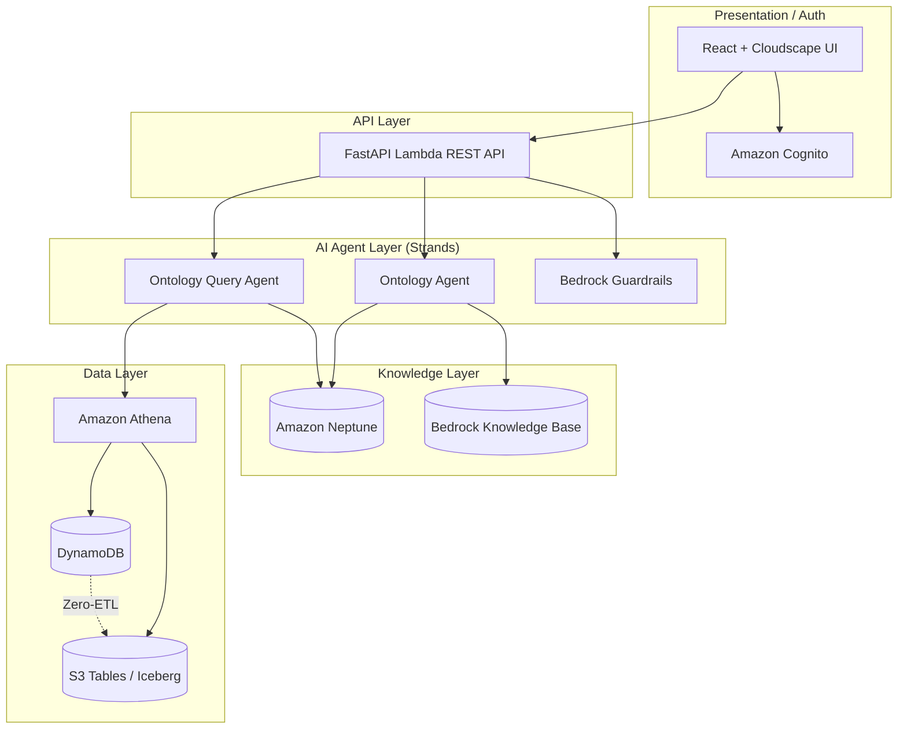
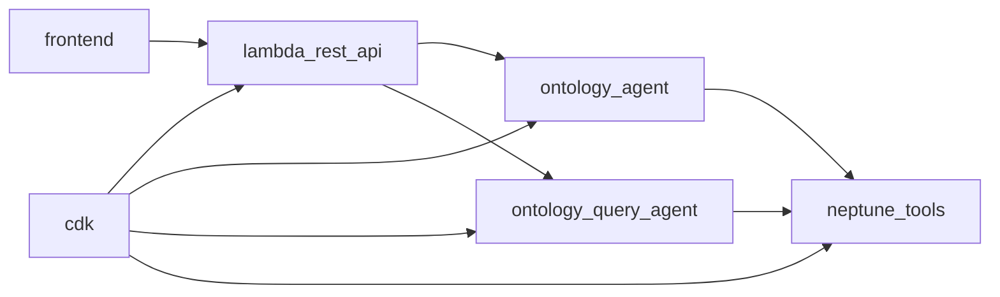
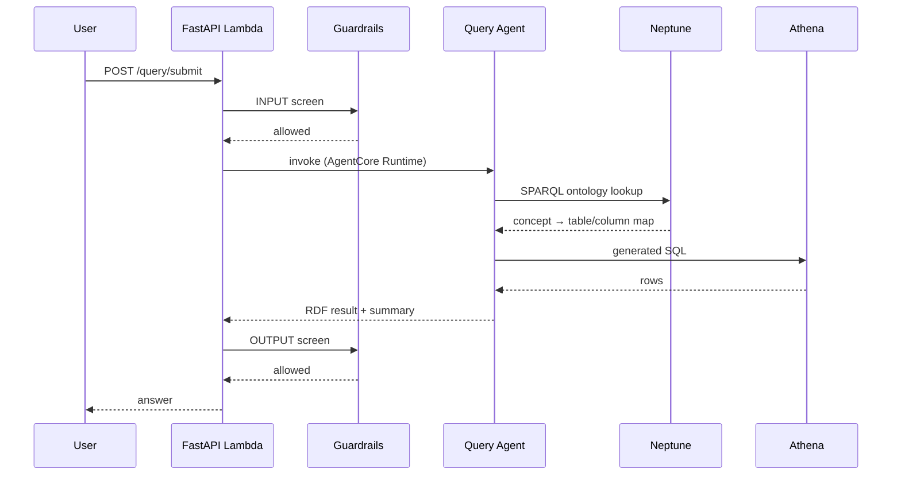

# Architecture

**sample-semantic-layer-structured** follows a layered, serverless AWS architecture organized as a CDK monorepo: a React presentation layer, a Cognito authentication layer, a FastAPI Lambda API layer, a Strands AI-agent layer, and knowledge/data layers backed by Amazon Neptune and S3 Tables.

## System Overview

The system separates **knowledge** (an OWL ontology describing business concepts) from **data** (the rows those concepts map to). An admin uses the React frontend to describe intent, select Glue-catalogued data sources, and trigger ontology generation. The **Ontology Agent** samples table schemas, retrieves design patterns from a Bedrock Knowledge Base, generates RDF/OWL N-Quads with `mapsToTable`/`mapsToColumn` traceability, and persists them to Amazon Neptune through an AgentCore Gateway.

End users ask natural-language questions through the same frontend. The **Ontology Query Agent** looks up the ontology in Neptune, disambiguates terms, generates SQL, executes it on Amazon Athena (federating DynamoDB and S3 Tables / Iceberg), and maps results back to RDF. Amazon Bedrock Guardrails screen both the user input and the agent output.

Underneath, a batch pipeline keeps analytical data fresh: Glue Zero-ETL replicates each DynamoDB table into S3 Tables (`zetl_<uuid>` namespaces), and a Glue 5.1 PySpark job materializes 40 normalized Iceberg views refreshed every six hours. All infrastructure is defined as code across 15 CDK stacks.

### Component Diagram

## Module Dependencies

## Key Design Decisions

- **Virtual Knowledge Graph over materialized graph**: the ontology stores concept→table/column mappings rather than copying data into the graph, so queries resolve to SQL on the source of truth (Athena) instead of duplicating rows in Neptune.
- **Strands Agents on Bedrock AgentCore Runtime**: each agent runs as its own containerized AgentCore Runtime (ontology + ontology-query), built for ARM64 via CodeBuild and shipped through a shared ECR repository.
- **AgentCore Neptune Gateway**: agents reach the VPC-isolated Neptune cluster through an HTTP gateway (backed by the `neptune-tools` MCP Lambda) instead of requiring VPC attachment.
- **Supervisor query loop**: the query agent uses a supervisor/runner pattern (`supervisor.py`, `supervisor_runner.py`) plus a `schema_digest` to iterate toward a correct SQL answer rather than a single shot.
- **Empty-by-default tables**: the 12 DynamoDB tables ship without data; customers load their own, and the schema feeds Zero-ETL and the 40 normalized views.
- **Fail-fast guardrails**: input is screened before any agent is invoked (saving compute on blocked queries), and output is screened before storage.

## Data Flow

A natural-language query flows from the browser through guardrails and the query agent to Athena and back:

## External Dependencies

| Dependency | Purpose | Version |
|-----------|---------|---------|
| AWS CDK | Infrastructure as code | v2 |
| Strands Agents SDK | Agent orchestration | — |
| Amazon Bedrock (Claude) | LLM inference | Claude (Sonnet) |
| Amazon Bedrock Knowledge Base | Ontology design-pattern retrieval | Titan Embed Text v2 |
| Amazon Neptune | RDF/OWL graph store + SPARQL | — |
| Amazon Athena | Federated SQL query engine | — |
| FastAPI + Mangum | HTTP API on Lambda | — |
| React + Cloudscape | Frontend UI | React 18, Cloudscape 3.0 |
| AWS Amplify Auth | Cognito integration | — |

---

*See also: [Modules](modules/) for detailed component documentation, [Journey](journey.md) for how the architecture evolved.*
