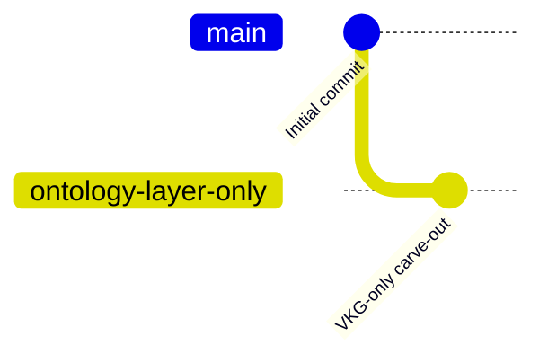

# Journey

**sample-semantic-layer-structured** was created on **2026-04-01** and has evolved through **2 commits** by **2 contributors** over roughly two months. The history is not a long incremental build but a two-act story: a full-featured reference implementation, followed by a deliberate carve-out into a customer-ready Virtual Knowledge Graph (VKG) distribution.

## Timeline

### Initial Reference Implementation (April 2026)

The project was initialized on 2026-04-01 by Felix Huthmacher with a single "Initial commit" that shipped the complete semantic-layer reference implementation. This original codebase covered far more than the current branch: Semantic RAG and metadata subsystems, a DynamoDB change-data-capture (CDC) pipeline, synthetic insurance sample data, multiple AI agents, the full CDK infrastructure, and the React frontend. Throughout April and May, automated Dependabot dependency bumps accumulated on remote branches but were never merged into `main`.

**Key events:**
- 2026-04-01 — `3228921` "Initial commit" (Felix Huthmacher): full reference implementation lands.
- 2026-04-02 → 2026-05-23 — 15 automated Dependabot dependency bumps on `origin/dependabot/*` branches (npm + pip), none merged.

### VKG-Only Carve-Out (June 2026)

Following the reference implementation, development shifted to producing an external customer distribution. On 2026-06-01, Saurabh Sarkar created the `ontology-layer-only` branch and committed a sweeping refactor that removed the Semantic RAG, metadata, and CDC subsystems; added a dedicated VKG query supervisor (`supervisor.py`, `supervisor_runner.py`, `schema_digest.py`) with Neptune ontology-fetch tooling; and stripped all synthetic sample data so customers bring their own. The same commit sanitized internal identifiers (a hardcoded AWS account number, internal profile names, and a local machine path) and rewrote the README with a Getting Started guide and prerequisites table. The change was overwhelmingly subtractive — 119 files changed, with about 3,400 insertions against 47,000 deletions.

**Key events:**
- 2026-06-01 — `1a9a07b` "Carve out VKG-only distribution; remove synthetic data and add getting-started guide" (Saurabh Sarkar): the defining change of this branch.

## Git Flow

## Release History

No version tags or releases exist in the repository.

## Notable Pull Requests

No pull requests or merge commits exist — the history is fully linear, and both commits were pushed directly. The 15 Dependabot dependency-bump branches off `origin/main` were never merged.

---

*See also: [Contributors](contributors.md) for who drove these changes, [Architecture](architecture.md) for the current state.*
