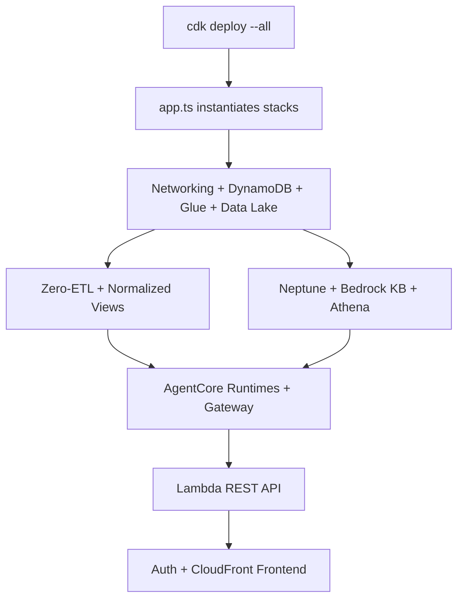

# CDK Infrastructure

**CDK Infrastructure** is the infrastructure-as-code module that defines and deploys the entire AWS environment for the solution as a set of 15 AWS CDK v2 (TypeScript) stacks.

## Overview

The CDK app entry point (`cdk/bin/app.ts`) instantiates every stack and wires their dependencies, so a single `cdk deploy --all` provisions networking, data stores, the knowledge graph, the AI agents, the API, authentication, and the frontend. Stacks are ordered by explicit dependencies — for example, the AgentCore stack depends on Neptune, the Bedrock Knowledge Base, Glue, Athena, and the data lake.

The backend stacks live in `cdk/lib/stacks/backend/` and the frontend hosting stacks in `cdk/lib/stacks/frontend/`. Reusable constructs (such as the ARM64 CodeBuild image builder and the AgentCore Neptune Gateway) are factored into `cdk/lib/common/constructs/` and `cdk/lib/stacks/backend/agentcore/`.

## Key Files

| File | Purpose |
|------|---------|
| `cdk/bin/app.ts` | App entry point; instantiates all 15 stacks and declares inter-stack dependencies |
| `cdk/lib/stacks/backend/networking-stack.ts` | VPC, subnets, security groups, VPC endpoints (with AgentCore AZ-ID guidance) |
| `cdk/lib/stacks/backend/dynamodb-stack.ts` | 12 empty insurance tables (pk/sk schema) + metadata table |
| `cdk/lib/stacks/backend/normalized-views-stack.ts` | Glue 5.1 PySpark job creating 40 normalized Iceberg views |
| `cdk/lib/stacks/backend/agentcore-stack.ts` | 2 AgentCore Runtimes, ECR repo, Neptune Gateway, LF grants |
| `cdk/lib/stacks/backend/lambda-rest-api/index.ts` | FastAPI Lambda + HTTP API Gateway with JWT authorizer |
| `cdk/cdk.json` | CDK context flags (auth, replication toggles) |

## Public API

The module exposes CDK `Stack` classes consumed by `app.ts`. Notable stacks:

### `NetworkingStack`
Creates the VPC and network primitives all VPC-bound resources depend on.

### `DynamoDBStack`
Creates the 12 empty operational tables and the `semantic-layer-metadata` table; grants Athena connector read access.

### `AgentCoreStack`
Provisions the ontology and ontology-query AgentCore Runtimes plus the Neptune Gateway construct.

### `NormalizedViewsStack`
Runs the Glue PySpark job that builds the 40 normalized materialized views and schedules a 6-hour refresh.

## Internal Flow

## Dependencies

- **Uses**: AWS CDK v2, AWS service constructs; builds/ships [Lambda REST API](lambda-rest-api.md), [Ontology Agent](ontology-agent.md), and [Ontology Query Agent](ontology-query-agent.md) images.
- **Used by**: Operators deploying the solution.

---

*Back to [Architecture](../architecture.md) | [All Modules](./)*
