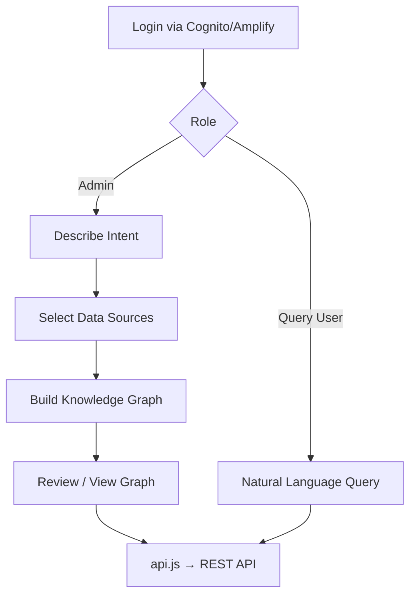

# Frontend

**Frontend** is the presentation module: a React 18 single-page application built with the AWS Cloudscape Design System that provides the admin and end-user interfaces.

## Overview

The frontend authenticates users with Amazon Cognito through AWS Amplify Auth and communicates with the [Lambda REST API](lambda-rest-api.md) over HTTPS using an Axios client (`src/services/api.js`). It is built as static assets and hosted on CloudFront + S3.

Two role-based experiences are provided. The **admin flow** walks an administrator through describing application intent, selecting Glue-catalogued data sources, building the knowledge graph, and reviewing the generated ontology. The **end-user flow** is a single natural-language query interface that displays answers and the agent's reasoning steps.

## Key Files

| File | Purpose |
|------|---------|
| `frontend/src/App.js` | App shell, routing, and auth wiring |
| `frontend/src/services/api.js` | Axios client; `ontologyAPI`, `dataSourceAPI`, query/neptune helpers |
| `frontend/src/pages/admin/DescribeIntent.jsx` | Step 1: capture intent and use cases |
| `frontend/src/pages/admin/SelectDataSources.jsx` | Step 2: choose Glue databases/tables |
| `frontend/src/pages/admin/BuildKnowledgeGraph.jsx` | Trigger ontology generation and show progress |
| `frontend/src/pages/admin/ViewKnowledgeGraph.jsx` | Interactive force-directed graph visualization |
| `frontend/src/pages/query/NaturalLanguageQuery.jsx` | End-user query input and results |

## Public API

The UI is organized as routed pages rather than exported functions. Service helpers in `api.js` include:

### `ontologyAPI`
`createOntologyConfig`, `buildOntology`, `getBuildStatus`, `getOntologyContent`, `getOntologyVersions`, `reviseOntology`, `uploadOntologyFile`, `deleteOntology`.

### `dataSourceAPI`
`listGlueDatabases` and related table-discovery calls.

## Internal Flow

## Dependencies

- **Uses**: React 18, Cloudscape Design System 3.0, AWS Amplify Auth, Axios, React Router v6; calls the [Lambda REST API](lambda-rest-api.md).
- **Used by**: End users and administrators; built and deployed by [CDK Infrastructure](cdk.md) (FrontendStack).

---

*Back to [Architecture](../architecture.md) | [All Modules](./)*
