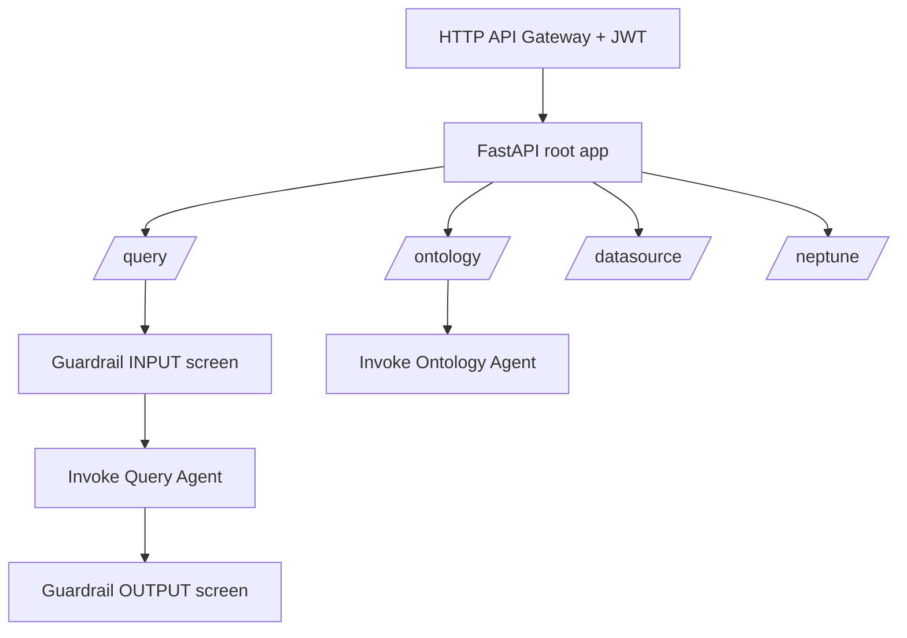

# Lambda REST API

**Lambda REST API** is the API module: a FastAPI application running on AWS Lambda that orchestrates the AI agents and exposes the operations the frontend consumes.

## Overview

The application (`lambda/rest-api/main.py`) is a root FastAPI app that mounts four sub-applications and is wrapped as a Lambda handler with Mangum. Requests arrive through an HTTP API Gateway protected by a Cognito JWT authorizer. The API translates frontend actions into agent invocations (via AgentCore Runtime ARNs), Glue/Athena calls, and Neptune operations, and applies Bedrock Guardrails to natural-language queries.

Business logic is factored into a `services/` layer so the route handlers stay thin. Guardrails are applied fail-fast: input is screened before any agent runs, and output is screened before it is stored or returned.

## Key Files

| File | Purpose |
|------|---------|
| `lambda/rest-api/main.py` | Root FastAPI app; mounts sub-apps and the Mangum handler |
| `lambda/rest-api/ontology_api.py` | `/ontology/*` — config, build, versions, revise, upload |
| `lambda/rest-api/query_api.py` | `/query/*` — submit, result, status |
| `lambda/rest-api/datasource_api.py` | `/datasource/*` — Glue database/table discovery |
| `lambda/rest-api/neptune_api.py` | `/neptune/*` — SPARQL operations |
| `lambda/rest-api/services/` | Service layer (ontology, query, glue, agentcore, neptune, guardrail) |

## Public API

The root app mounts four sub-apps:

### `/ontology/*`
Config CRUD, `POST /ontology/build/{id}` to trigger the [Ontology Agent](ontology-agent.md), build status, versions, content, revise, and upload.

### `/query/*`
`POST /query/submit`, `GET /query/result/{id}`, `GET /query/status/{id}` — natural-language queries routed to the [Ontology Query Agent](ontology-query-agent.md) with guardrail screening.

### `/datasource/*`
Lists Glue Catalog databases and tables (including S3 Tables / Iceberg).

### `/neptune/*`
SPARQL query operations against the ontology graph.

## Internal Flow

## Dependencies

- **Uses**: FastAPI, Mangum, boto3; invokes [Ontology Agent](ontology-agent.md) and [Ontology Query Agent](ontology-query-agent.md); calls Glue, Athena, Neptune, DynamoDB, and Bedrock Guardrails.
- **Used by**: [Frontend](frontend.md) via Axios; provisioned by [CDK Infrastructure](cdk.md).

---

*Back to [Architecture](../architecture.md) | [All Modules](./)*
