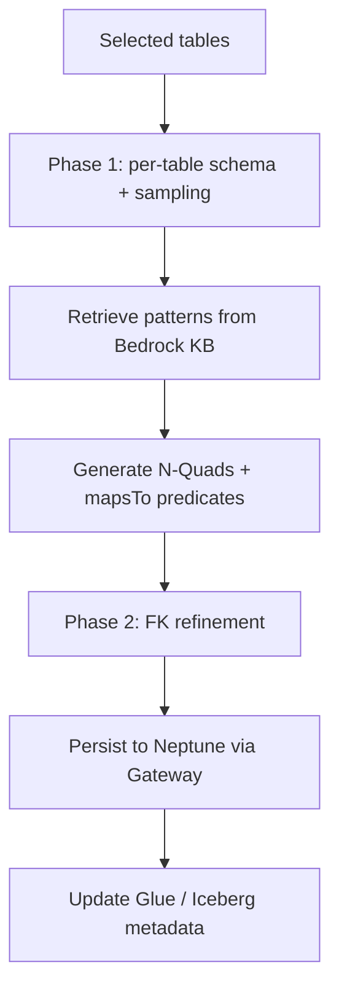

# Ontology Agent

**Ontology Agent** is the generation module that produces an OWL ontology from AWS Glue schemas and table sampling, persisting it to Amazon Neptune as RDF/OWL with traceability back to physical tables and columns.

## Overview

The agent is a Strands Agent running on a Bedrock AgentCore Runtime. Given a set of selected data sources, it samples each table's schema and data, retrieves relevant ontology design patterns from a Bedrock Knowledge Base, and generates N-Quads describing business concepts, relationships, and their `mapsToTable`/`mapsToColumn` mappings. The N-Quads are written to Neptune named graphs through the AgentCore Neptune Gateway, and column descriptions are written back to the Glue Data Catalog and Iceberg metadata.

Generation is organized into phases with a fresh sub-agent per table: Phase 1 produces per-table N-Quads, Phase 2 refines foreign keys and persists to Neptune, and a Revision mode applies targeted edits for human-in-the-loop refinement.

## Key Files

| File | Purpose |
|------|---------|
| `agents/ontology_agent/main.py` | Agent entry point, tool definitions, and phase orchestration |
| `agents/ontology_agent/prompt_builder.py` | Constructs the generation/refinement prompts |
| `agents/ontology_agent/token_manager.py` | Tracks and bounds token usage |
| `agents/Dockerfile.ontology` | ARM64 container image for the AgentCore Runtime |

## Public API

The agent exposes Strands `@tool` functions invoked by the model, including:

### `get_single_table_schema(database_name, table_name, catalog_id)`
Returns a single table's schema for sampling.

### `retrieve_ontology_patterns(schema_description, max_patterns)`
Retrieves OWL design patterns from the Bedrock Knowledge Base.

### `append_nquads(ontology_id, table_name, nquad_batch)`
Appends generated N-Quads for a table to the working ontology.

### `persist_file_to_neptune(ontology_id, table_name)`
Persists the assembled N-Quads to Neptune via the gateway.

### `update_glue_metadata_from_ontology(ontology_id, database_name, table_name, catalog_id)`
Writes AI-generated column descriptions back to the Glue catalog.

## Internal Flow

## Dependencies

- **Uses**: Bedrock (Claude), Bedrock Knowledge Base, AWS Glue, S3, DynamoDB metadata table, Amazon Neptune (via [neptune-tools](../architecture.md) gateway).
- **Used by**: [Lambda REST API](lambda-rest-api.md) (`/ontology/build`), triggered from the [Frontend](frontend.md) admin flow.

---

*Back to [Architecture](../architecture.md) | [All Modules](./)*
