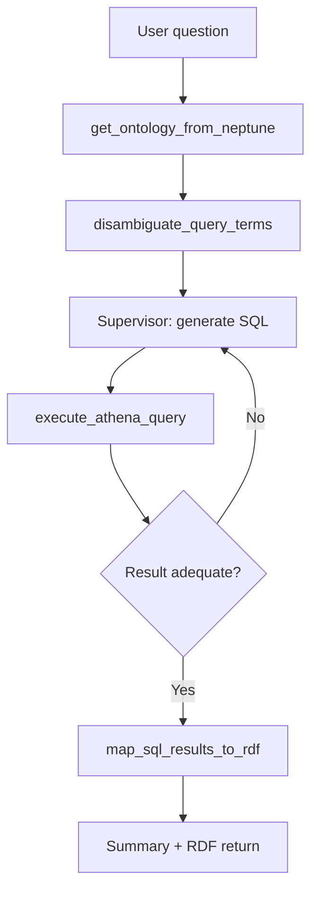

# Ontology Query Agent

**Ontology Query Agent** is the query module that translates natural-language questions into SPARQL ontology lookups and SQL executed on Amazon Athena, returning results mapped back to RDF.

## Overview

Like the generation agent, this is a Strands Agent on a Bedrock AgentCore Runtime. It reads the ontology from Neptune to understand which business concepts map to which tables and columns, disambiguates the user's terms against that ontology, generates SQL, executes it on Athena (federating DynamoDB and S3 Tables / Iceberg), and maps the rows back into RDF for presentation.

Rather than answering in a single pass, the agent uses a **supervisor loop** (`supervisor.py` + `supervisor_runner.py`) that orchestrates the lookup → generate → execute cycle, supported by a `schema_digest` that condenses table schemas to ground SQL generation. Row limits are dynamic: a default of 10, a user-specified count (e.g. "top 30"), capped at 100.

## Key Files

| File | Purpose |
|------|---------|
| `agents/ontology_query_agent/main.py` | Agent entry point and `@tool` definitions |
| `agents/ontology_query_agent/supervisor.py` | Supervisor that plans and coordinates the query loop |
| `agents/ontology_query_agent/supervisor_runner.py` | Drives supervisor iterations and merges results |
| `agents/ontology_query_agent/schema_digest.py` | Builds a condensed schema representation for SQL grounding |
| `agents/ontology_query_agent/query_prompts.py` | Prompt templates for query translation |
| `agents/Dockerfile.ontologyquery` | ARM64 container image for the AgentCore Runtime |

## Public API

The agent exposes Strands `@tool` functions, including:

### `discover_named_graphs()`
Lists the ontology's Neptune named graphs.

### `get_ontology_from_neptune(...)`
Fetches the ontology (concept/table/column mappings) from Neptune.

### `disambiguate_query_terms(user_query, ontology_info, ...)`
Resolves user terms against ontology concepts to avoid false matches.

### `execute_athena_query(...)`
Runs the generated SQL on Athena.

### `map_sql_results_to_rdf(query_results, ontology_info, max_rows=10)`
Maps returned rows back into RDF N-Quads.

## Internal Flow

## Dependencies

- **Uses**: Bedrock (Claude), Amazon Neptune (SPARQL via gateway), Amazon Athena, DynamoDB, Bedrock Guardrails.
- **Used by**: [Lambda REST API](lambda-rest-api.md) (`/query/submit`), invoked from the [Frontend](frontend.md) query page.

---

*Back to [Architecture](../architecture.md) | [All Modules](./)*
